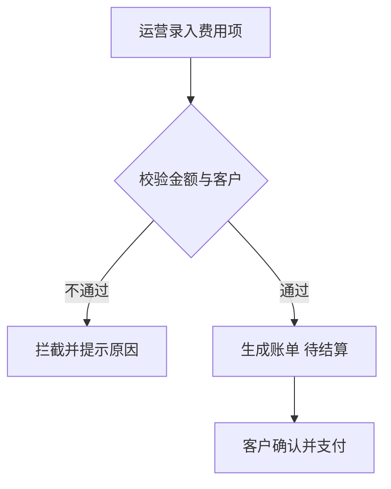

# 示例业务域（example-service）

## 职责定位

用 2~3 句大白话说明这个业务域管什么、给谁用、在整盘生意里的位置。
再举一个具体业务例子，让运营能在脑子里"演"出来。
（示例文案，生成时替换为实际业务内容；不出现类名、SQL 等技术词，技术依据统一放文末折叠区。）

## 管哪些业务单据

| 业务单据 | 状态词典 | 单据说明 |
|---|---|---|
| 示例账单 | 正常 / 已撤销 / 已退单 | 记录客户每期应付的费用…… |
| 示例结算单 | 待结算 / 结算中 / 结算完成 | 汇总多张账单的一次性结清…… |

状态词典完整列出：从索引枚举事实中取"code + 中文含义"全量列出，不挑选。

## 核心业务流程

### 账单创建流程是怎么走的

（每个流程小节标题用运营会问的原话，例如"账单创建流程是怎么走的"，不用"核心流程"这类抽象泛词——运营按问题找章节。）

1. 运营录入费用项，系统校验金额与客户信息；
2. 校验不通过则拦截，提示具体原因（见校验规则区）；
3. 校验通过后生成"待结算"状态的账单；
4. 客户确认并支付，账单进入下一状态。

（每张图必须配等价文字步骤：图给人快速理解，文字保证复制、打印、纯文本阅读场景完整。流转路径由调用链推断，已在技术依据区标注推断依据。）

## 业务规则

> 水位声明：本模块校验规则穷举自 87 处异常拦截点；状态词典穷举自 12 个状态枚举；计算规则为代表性提取（8 条）；边界规则为代表性提取（5 条）。

### 校验规则

（每条规则按五要素写：条件 → 结论；有例外必须写；来源进折叠区并标证据等级。）

- 当支付金额大于待付金额时，系统拦截支付并提示"支付金额不能大于待付金额"。例外：走人工审批通道的账单不受此限制。 

证据
PayServiceImpl.java:660（源码已复核，穷举来源 #12）

### 状态与流转

状态词典（穷举）见"管哪些业务单据"。流转路径：正常 → 已撤销（运营撤销时触发，推断：撤销入口调用链）。

### 计算规则

- 应退金额 = 调整后总金额 − 已支付金额，保留 2 位小数四舍五入。

### 边界规则

- 账单只能在创建后 90 天内发起冲正，超期需走人工通道。

## 上下游关系

- 上游：示例基础服务把客户与车辆档案同步过来；
- 下游：示例财务对接域把结清数据推送到集团财务系统。

（上下游依据跨模块依赖事实，引用具体方向与强度，不写技术调用细节。）

## 功能清单

| 功能 | 说明 | 入口 |
|---|---|---|
| 账单分页查询 | 按客户/车牌/状态筛选账单 | 结算工作台 → 账单列表 |
| 发起结算 | 对选中账单一次性结清 | 账单列表 → 发起结算 |

## 技术依据

全部技术依据（file:line 级证据，供开发审计）

- 模块规模：1505 文件 / 87172 代码节点（graph_facts.py 输出）
- 校验规则穷举来源：拦截点全量扫描（87 处），逐条对应上文
- 状态词典：XxxStatusEnum（共享库 enums/ 目录）等 12 个枚举，源码已复核
- 流转推断依据：撤销入口 → 状态更新调用链（等级：推断）
- 上下游事实：cross_module 依赖矩阵 example-service → example-framework（11428 条边，等级：索引图谱关系）

