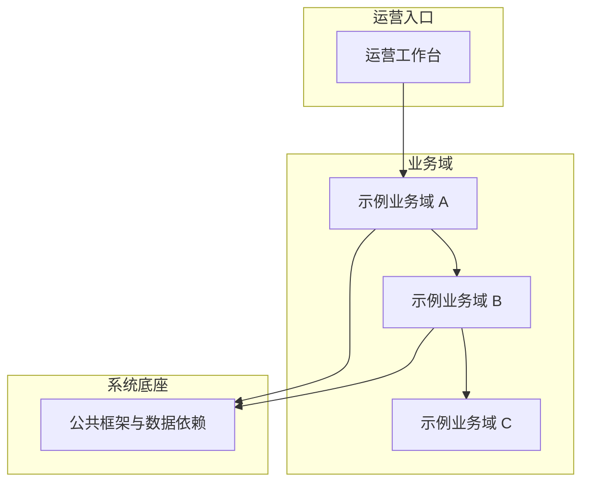

# 示例项目业务全景（面向运营）

## 这个系统是干什么的

用 3 句大白话讲清楚：这个系统替谁、管什么生意、最核心的三件事是什么。
关键数字：N 个业务模块、M 类业务单据、日均处理 X 单（有事实来源才写，没有就去掉数字）。

## 业务全景图

（全景图按业务域画，箭头是业务往来不是技术调用；每张图配文字版。）

全景图文字版：运营在工作台操作，进入业务域 A 处理单据；业务域 A 依赖公共底座提供的状态词典与计算口径；结清后的数据流向业务域 B 与 C。

## 业务模块一览

| 业务域 | 一句话职责 | 上下游 |
|---|---|---|
| 示例业务域 A | 管账单的生成与结清 | 上游基础档案，下游财务对接 |

## 阅读指引

- 想查"为什么被拦"→ 对应业务域文档的"业务规则 → 校验规则"
- 想了解"一个流程怎么走"→ 对应业务域文档的"核心业务流程"
- 不认识的词 → [术语表](术语表.md)
- 各业务域详解 → [01-示例业务域](01-示例业务域.md) · [运营工作台](运营工作台.md) · [系统底座](系统底座.md)
